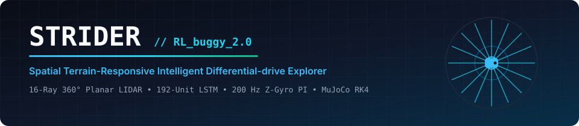
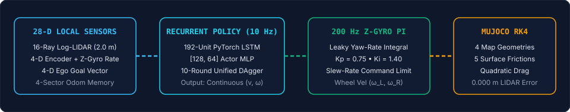

<div align="center">



<br />


<p>
  
  
  
  
  
</p>

</div>

---

## Meet STRIDER

**STRIDER** (*Spatial Terrain-Responsive Intelligent Differential-drive Explorer*) is the second-generation autonomous navigation agent in **`RL_buggy_2.0`**. Built on a 16-ray 360° planar LIDAR sensor suite, a 192-unit PyTorch LSTM policy trained via Unified DAgger, and a 200 Hz leaky Z-gyro PI inner loop, STRIDER navigates unseen mazes, low-friction ice hairpins, high-drag mud chambers, and blind dead ends with **zero global map input** and **zero wall collisions**.

---

## Quantitative Highlights

<div align="center">
  
</div>

<br />

| Category | Specification | Measured Value |
| :--- | :--- | :--- |
| **Held-Out Benchmark** | 40 Unseen Multi-Zone Maps (4 Families) | **95.0% (`38/40`)** (`10/10` on `ortho`, `curve`, `open`) |
| **Stress-Test Benchmark** | 80 Unseen Multi-Zone Maps (Noise ON) | **92.5% (`74/80`)** across all 4 geometry families |
| **Collision Safety** | Zero-Hit Rate Across All Solved Runs | **100% (`38/38` held-out, `74/74` stress test)** |
| **Showcase Gauntlet** | 4.25 × 4.25 m 5-Terrain Dead-End Course | **50.8 s** • **0 wall hits** • **180° backtracking** |
| **Policy Interface** | Observation / Continuous Action Space | **28-dim** local vector / **Box(2)** (`v`, `ω`) at **10 Hz** |
| **Low-Level Control** | Z-Gyro PI Inner Loop / Max Linear Speed | **200 Hz** (`5 ms` RK4 tick) / **0.48 m/s** (`Kp=0.75, Ki=1.40`) |
| **Robot Kinematics** | Wheel Radius / Track Width / Max Wheel Vel | **r = 0.032 m** / **L = 0.135 m** / **22.0 rad/s** |
| **Sensor Suite** | Planar LIDAR / Cutoff / Near-Field Encoding | **16-ray 360°** (`22.5°` step) / **2.0 m** / `log1p(d/0.18)` |
| **Training Pipeline** | Expert Teacher + 10-Round Unified DAgger | **100% (`20/20`, 0-hit)** Dijkstra+LOS → **192-unit LSTM** |

---

## What Changed from `RL_Maze_Buggy` (v1.0) to STRIDER (`2.0`)

While **v1.0** solved orthogonal grid mazes (`5×5` to `7×7`) using discrete cell-by-cell moves on uniform flat terrain, **STRIDER (`RL_buggy_2.0`)** upgrades perception, control, physics, and training into a **single continuous-control policy** that generalizes across arbitrary geometries and surface frictions with zero mode routers:

| Dimension | `RL_Maze_Buggy` (v1.0) | STRIDER (`RL_buggy_2.0`) |
| :--- | :--- | :--- |
| **LIDAR Perception** | 6 forward-biased ToF rays (`1.2 m` linear) | **16-ray 360° planar LIDAR** (`2.0 m` cutoff) with **log-scale near-field encoding** (`log1p(d / 0.18)`) for 3× shoulder resolution |
| **Geometry Scope** | Orthogonal `90°` grid corridors only | **4 unified map families:** `ortho_maze`, `curve_track` (hairpins, chicanes, pinches), `open_arena` (pillars, boxes, baffles), `hybrid_arena` |
| **Terrain Physics** | Uniform flat floor friction | **5 multi-zone surfaces:** `Pavement` ($\mu=1.00$), `Gravel` ($\mu=0.65$), `Sand` ($\mu=0.50$), `Mud` ($\mu=0.35$), `Ice` ($\mu=0.08$) + quadratic drag |
| **Action & Control** | `Discrete(4)` cell steps (`0.30 m` stride) | **Continuous `(v, ω)` velocity control (`10 Hz`)** stabilized by a **200 Hz leaky Z-gyro PI yaw-rate inner loop** |
| **Spatial Memory** | Cell-stepped LSTM + cardinal flags | **28-D continuous state** with **4-sector dead-reckoned odometry visited-density memory** + 192-unit LSTM |
| **Teacher & Training** | Grid BFS imitation + PPO | **Universal Centerline Teacher** (clearance-weighted Dijkstra + LOS Pure Pursuit) + **10-Round Unified DAgger** |

---

## Live Multi-Terrain Showcase Gauntlet

STRIDER (`checkpoints/unified_lidar_v2_95pct_0hit.zip`) solving a custom **4.25 m × 4.25 m** gauntlet combining **90° maze turns**, a **blind L-shaped Euclidean-lure dead end with 180° backtracking**, a **continuous 180° low-friction Ice hairpin ($\mu = 0.08$)**, **high-drag Sand**, and an **open Mud pillar chamber**—with **0 wall hits**:

PASTE_SHOWCASE_VIDEO_HERE

---

## Architecture

STRIDER decouples **continuous high-level navigation & memory** from **high-frequency slip-compensated wheel control** into a two-tier hierarchy. Separating strategic pathing from fast yaw-rate stabilization allows one frozen LSTM policy to handle ice hairpins, mud drag, open pillar chambers, and narrow doorway re-entries without mode switching.

<div align="center">
  
</div>

<br />

- **Local Perception (`28-Dim`):** Never receives a global map. At `10 Hz`, STRIDER fuses **16 log-scaled 360° LIDAR rays** (`log1p(d / 0.18)`, `2.0 m` cutoff), **4 noisy kinematic channels** (encoder speed, Z-gyro rate, previous `v, ω`), a **4-D ego-frame goal vector**, and a **4-sector odometry visited-density tracker**.
- **High-Level Policy (`192-Unit LSTM`):** Trained via **10-round Unified DAgger** against a `100% (0-hit)` clearance-weighted Dijkstra + LOS Pure Pursuit teacher across all four map families, outputting smooth continuous `(v, ω)` commands and using recurrent memory to backtrack out of blind dead ends.
- **Low-Level Controller (`200 Hz Leaky Z-Gyro PI`):** Runs every `5 ms` MuJoCo `RK4` tick, feeding Z-gyro yaw rate into a leaky PI loop (`Kp = 0.75`, `Ki = 1.40`) with slew-rate limiting to suppress lateral drift on ice ($\mu = 0.08$) and execute zero-radius `180°` pivots.
- **Multi-Zone Terrain Physics:** Voronoi surface patches dynamically modulate sliding/torsional/rolling friction and quadratic velocity drag across `Pavement`, `Gravel`, `Sand`, `Mud`, and `Ice` while preserving exact `0.000 m` raycast calibration.

---

## Quick Setup & Running Guide

### 1. Clone & Create Virtual Environment
```bash
git clone [https://github.com/nlskarthik007/RL_buggy_2.0.git](https://github.com/nlskarthik007/RL_buggy_2.0.git)
cd RL_buggy_2.0

python3 -m venv .venv
source .venv/bin/activate        # Linux / macOS
# .venv\Scripts\activate         # Windows PowerShell

## Quick Setup & Running Guide

```bash
git clone https://github.com/nlskarthik007/RL_buggy_2.0.git
cd RL_buggy_2.0

python3 -m venv .venv
source .venv/bin/activate        # Linux / macOS
# .venv\Scripts\activate         # Windows PowerShell

2. Install Dependencies
Requires Python 3.10+:

Bash
pip install --upgrade pip
pip install mujoco gymnasium stable-baselines3 sb3-contrib torch numpy "imageio[ffmpeg]"

3. Run the Pre-Trained Unified Agent (95.0% / 0-Hit Champion)
40-Map Held-Out Benchmark across all 4 geometry/terrain families:

Bash
python3 train_unified_v2.py --eval checkpoints/unified_lidar_v2_95pct_0hit.zip
Interactive 3D Viewer (ortho_maze | curve_track | open_arena | hybrid_arena):

Bash
LC_ALL=C.UTF-8 python3 train_unified_v2.py --view hybrid_arena 9803 checkpoints/unified_lidar_v2_95pct_0hit.zip
Multi-Terrain Showcase Gauntlet (90° turns + dead-end backtracking + Ice hairpin + Mud pillar room):

